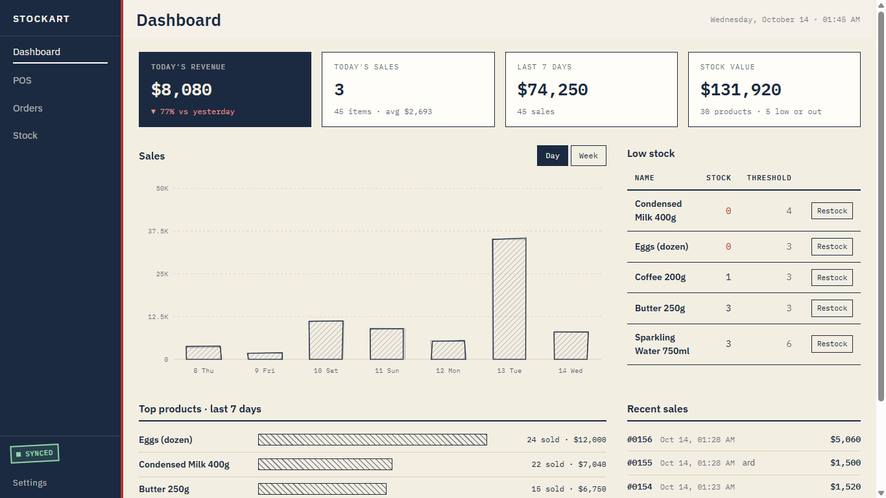
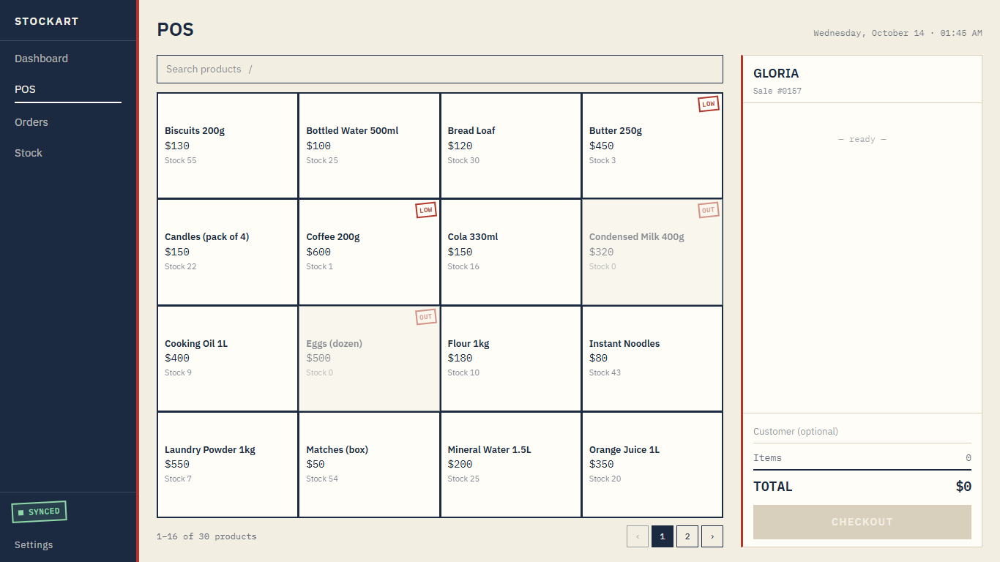
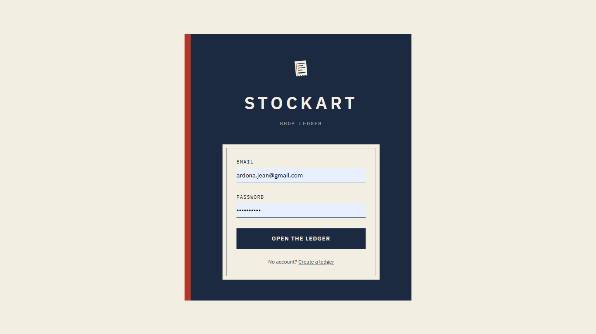

# Stockart

**A shop management app that keeps working when the internet doesn't.**
Point of sale, stock, orders and a dashboard for small shops, with a paper-ledger identity instead of a generic SaaS look.

- **Live demo:** https://stockart.vercel.app
- **Demo video:** YOUR_VIDEO_LINK !
- Built for the **Devpost "Build With AI: Basics 2026"** hackathon



---

## The problem

Many small shops run on a paper notebook or a spreadsheet. The online tools that could replace them stop working the moment the connection drops, and for a shop that sells all day, a tool that is down is a tool that gets abandoned. Notebooks, on the other hand, can't tell you what sold best this week or what is about to run out.

## The solution

Stockart is a **local-first** web app. Every sale, restock and change is written to the browser's own database first, so the shop keeps selling with or without internet. When the connection comes back, everything is pushed to the cloud automatically, and the sync stamp in the sidebar shows exactly where things stand.

It is designed for a computer (big screen, keyboard, mouse) and looks like a shopkeeper's ledger: cream paper, ink-blue, a red margin rule, rubber-stamp details and a receipt strip that behaves like a thermal printer.



## Features

**Point of sale**
- Product grid with search (press `/`), pagination and **LOW** / **OUT** stamps
- Receipt strip with `−` / `+` per line, live total, optional customer name
- Quantities can never exceed the stock on hand
- Checkout stamps the receipt **PAID**, resets for the next customer and offers a **PDF receipt**
- Works fully offline

**Orders**
- Every sale, grouped by day, with the receipt preview next to it
- **Print again** at any time (prices and names are the ones from the day of the sale)
- Search by sale number or customer
- **Export CSV** of all operations (sales and stock movements) for any period

**Stock**
- Add, edit and archive products (archived products keep their sales history)
- Restock with an optional purchase price, or adjust with a required reason
- Stock is **never edited directly**: it only changes through recorded movements, and a History tab lists them all

**Dashboard**
- Today's revenue (compared with yesterday), sales count, last 7 days, stock value
- Hand-drawn sales chart (day / week) drawn in plain SVG, no chart library
- Top products and recent sales
- Low-stock list with a direct **Restock** button

**Sync and accounts**
- Email and password accounts through Supabase Auth
- Sync stamp: `SYNCED` · `PENDING` · `OFFLINE` · `SIGN IN TO SYNC`
- Installable as a PWA



## How offline-first works

1. **Dexie (IndexedDB) is the source of truth.** The app only reads from and writes to the local database, online or not.
2. Every change also adds an entry to a **sync queue**. The entry only says *which* record changed; the record itself is read fresh when it is sent.
3. A sync engine pushes the queue to Supabase:
   - **in foreign-key order**: shop settings, products, sales, sale items, stock movements
   - with **upsert on a client-generated UUID**, so retrying never creates duplicates
   - and retries **when the browser comes back online, when the app starts, shortly after any change, and every 30 seconds** while something is pending
4. **Row Level Security** on every Supabase table: each row carries a `user_id` and each user can only read and write their own rows.
5. A one-time **backfill** queues any local data created before sync existed, so nothing is left behind.
6. Money is stored as **integers** in the smallest unit, and each sale line stores a **snapshot** of the product name and price, so editing a product never rewrites history.

The sync logic lives in `src/lib/syncCore.ts` (plain functions, no React) and `src/lib/syncEngine.ts`.

## Tech stack

React · TypeScript · Vite · Tailwind CSS · React Router · Dexie · Supabase (Auth, Postgres, RLS) · vite-plugin-pwa · IBM Plex (bundled locally, so the identity survives offline)

No AI features inside the app and no paid services: Supabase and Vercel free tiers only.

## Run it locally

```bash
git clone https://github.com/Jean-ardona/STOCKART.git
cd STOCKART
npm install
cp .env.example .env.local   # then fill in your Supabase values
npm run dev
```

1. Create a free project at [supabase.com](https://supabase.com).
2. Open the **SQL Editor** and run `supabase/schema.sql` (tables, foreign keys and RLS policies).
3. In **Authentication**, turn off *Confirm email* so sign-up works instantly.
4. Put your project URL and anon key in `.env.local`:
   ```
   VITE_SUPABASE_URL=https://xxxx.supabase.co
   VITE_SUPABASE_ANON_KEY=your-anon-key
   ```

**Test the offline mode** (service workers only run in production builds):

```bash
npm run build
npm run preview
```

Open the preview URL, reload once with internet, then switch DevTools → Network → **Offline** and reload: the app still opens and sales still work. Switch back online and watch the sync stamp go from `PENDING` to `SYNCED`.

## Try it in two minutes

1. Create an account and fill in the shop setup (sample products are loaded for you).
2. Open **POS**, add a few products, adjust quantities and **Checkout**.
3. Go offline in DevTools and make another sale. The stamp reads `OFFLINE · 1 SALE PENDING`.
4. Go back online. The sale reaches Supabase and the stamp turns green.
5. Open **Orders**, select a sale, **Print again**, then **Export CSV**.

## How it was built

Stockart was planned and built with the **Devpost Learn skill pack in Kiro**. The planning documents (scope, PRD, technical spec and build plan) are in [`devpost/`](./devpost), and the visual identity is specified in [`design/DESIGN.md`](./design/DESIGN.md).

Claude (Anthropic) was used alongside Kiro as a pair-programming and design assistant: it helped write the Stock, Dashboard and Orders screens, the sync engine, receipt printing and CSV export, and every piece was tested before being added to the project.

## Known limits (MVP)

- Sync goes **one way** (device to cloud) and assumes one device per account. Sale numbers are generated on the device.
- No refunds or order cancellation yet.
- Interface in English only (all texts are in `src/lib/strings.ts`, ready to translate).
- Supabase free projects pause after a period of inactivity; open the dashboard to wake them up.

## Roadmap (v2)

- Customers and debts (who owes how much)
- Two-way sync and multiple devices
- Multiple users and roles (owner, cashier)
- Refunds and order cancellation
- Barcode scanning
- More payment methods, including mobile money
- French and other languages
- Tablet and phone layouts

## Project structure

```
src/
  pages/        Dashboard, POS, Orders, Stock, Login, Setup
  components/   layout, pos, stock, orders, dashboard
  lib/          db (Dexie), completeSale, stockOps, syncCore, syncEngine,
                printReceipt, exportOperations, dashboardStats, strings
  hooks/        data and sync hooks
supabase/       schema.sql (tables, foreign keys, RLS)
design/         DESIGN.md (visual identity)
devpost/        planning documents from the Devpost Learn skill pack
```
